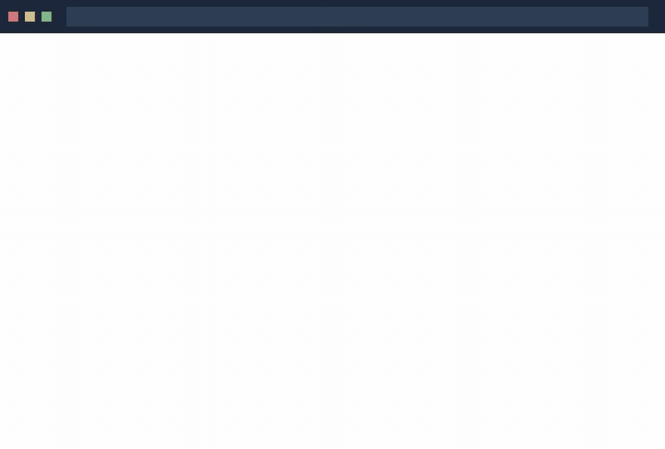

# Stapler Squad [](https://github.com/tstapler/stapler-squad/actions/workflows/build.yml) [](https://github.com/tstapler/stapler-squad/releases/latest)

[Stapler Squad](https://tstapler.github.io/stapler-squad/) is a web-based mission control for running multiple AI coding agents ([Claude Code](https://github.com/anthropics/claude-code), [Codex](https://github.com/openai/codex), [Gemini](https://github.com/google-gemini/gemini-cli), [Aider](https://github.com/Aider-AI/aider)) simultaneously — with a real-time dashboard, automatic approval rules, and a structured review queue. Run it with `ssq`, then open `http://localhost:8543`.



<details>
<summary>Full video</summary>
<video src="assets/demo.webm" width="100%" autoplay loop muted controls></video>
</details>

→ [Feature screenshots](docs/features.md)

**Jump to:** [Highlights](#highlights) · [Why Stapler Squad?](#why-stapler-squad) · [How It Works](#how-it-works) · [Installation](#installation) · [Configuration](#configuration) · [Usage](#usage) · [Development](#development) · [FAQs](#faqs)

### Highlights

**Visibility**
- **Real-time dashboard** — status badges, diff stats, tags, and approvals for all agents in one view
- **Live terminal streaming** — full xterm.js terminal per session, no SSH required
- **Diff viewer** — per-session git diff with VCS context at a glance
- **Notifications** — real-time alerts when agents need attention

**Organisation**
- **Instant search** — filter across titles, paths, branches, and tags as you type
- **Tag-based grouping** — view sessions across 8 grouping strategies (tag, category, status, branch, and more)
- **Workspace switcher** — manage multiple project contexts from one UI
- **Bulk actions** — select and act on multiple sessions simultaneously

**Review & Approval**
- **Auto-approval rules engine** — 100+ built-in rules block dangerous operations automatically; add custom rules to approve safe, repetitive actions without manual review
- **Review Queue** — structured triage before any agent change reaches your codebase
- **Approval analytics** — visualise decision trends and classifier performance over time

**History & Debugging**
- **History search** — searchable, filterable record of every agent action across all sessions
- **Logs viewer** — live-tail application logs with time range, export, and density controls
- **Config viewer** — inspect and understand your current configuration from the UI

**Infrastructure**
- Each agent gets its own **isolated git workspace** — no branch conflicts

<br />

### Why Stapler Squad?

Stapler Squad started as a fork of [claude-squad](https://github.com/smtg-ai/claude-squad), a terminal UI for managing multiple Claude Code sessions. Two things pushed me toward a full rewrite:

**A browser is a better interface for this job.** It opens instantly in multiple windows, works over SSH without port-forwarding a terminal, and lets you check on agents from any device — including your phone, via the built-in WebAuthn passkey remote access. Terminal UIs are great for one focused session; less so when six agents are running across different services and you want to glance at all of them while doing something else.

**Claude is better at building web UIs than TUIs.** The Bubble Tea/Charm ecosystem is relatively niche, which means less training data and slower iteration. React and Next.js are Claude's home turf — features that take days to wrangle in a TUI come together in hours.

The result is opinionated toward supervised, human-in-the-loop agent work: approval gates before changes land, a rules engine to automate the repetitive stuff, and a review queue so nothing slips through unnoticed.

#### How it compares

|  | Interface | Platforms | Isolation | Review & approval | License |
|---|---|---|---|---|---|
| **Stapler Squad** | Web dashboard, self-hosted (+ remote access via WebAuthn passkey) | macOS, Linux | tmux + git worktrees | Auto-approval rules engine with risk classification, Review Queue, approval analytics | AGPL-3.0 |
| [claude-squad](https://github.com/smtg-ai/claude-squad) | Terminal UI | macOS, Linux | tmux + git worktrees | Manual diff/merge from the TUI | AGPL-3.0 |
| [Conductor](https://conductor.build) | Native desktop app | macOS only | git worktrees | Diff viewer, manual review | Free, proprietary |
| [Nimbalyst](https://nimbalyst.com) (successor to Crystal) | Desktop app + iOS companion | macOS, Windows, Linux | git worktrees | Diff viewer, manual review | MIT |
| [Orca](https://www.onorca.dev) | Desktop IDE + iOS/Android companion | macOS, Windows, Linux | git worktrees (+ SSH remote worktrees, self-hosted servers) | Diff viewer with inline annotations back to the agent | MIT |
| [Vibe Kanban](https://github.com/BloopAI/vibe-kanban) | Web UI (kanban board), local-first | Cross-platform (`npx`) | git worktrees | Inline diff comments back to the agent | Open source, community-maintained |

If you want the smallest possible footprint and don't need approval gates, claude-squad (the project this forked from) is a solid pick. If you want a native Mac app, look at Conductor or Nimbalyst. If you want the deepest feature set in a desktop IDE — mobile companion, SSH/remote worktrees, an embedded browser with a "Design Mode," native GitHub/Linear integration — Orca is the one to look at. If Stapler Squad's rules engine, review queue, and remote-access dashboard match how you work, you'll feel at home here — if not, any of the above are good alternatives.

*(Comparison current as of October 2026 and based on each project's public docs/README, not hands-on testing of every one — this space moves fast, so check the linked project before deciding.)*

### How It Works

1. **tmux** to create isolated terminal sessions for each agent
2. **git worktrees** to isolate codebases so each session works on its own branch
3. A web UI for real-time session management, approvals, and review

### Installation

Both Homebrew and manual installation will install Stapler Squad as `ssq` on your system.

#### Homebrew

```bash
brew tap tstapler/stapler-squad https://github.com/tstapler/stapler-squad && brew install tstapler/stapler-squad/stapler-squad
```

This installs both `stapler-squad` and the `ssq` alias.

#### Manual (pre-built binary)

Download and install the latest pre-built binary:

```bash
curl -fsSL https://raw.githubusercontent.com/tstapler/stapler-squad/main/install.sh | bash
```

This puts the `ssq` binary in `~/.local/bin`.

To use a custom name for the binary:

```bash
curl -fsSL https://raw.githubusercontent.com/tstapler/stapler-squad/main/install.sh | bash -s -- --name <your-binary-name>
```

#### Build from Source

Build and install directly from source. The script installs Go via Homebrew if it isn't already present, then compiles the full application (web UI + server) and puts `ssq` in `~/.local/bin`:

```bash
curl -fsSL https://raw.githubusercontent.com/tstapler/stapler-squad/main/install.sh | bash -s -- --from-source
```

Or step by step:

```bash
# 1. Install build dependencies (Go, Node.js, buf)
brew install go node buf

# 2. Clone the repository
git clone https://github.com/tstapler/stapler-squad.git
cd stapler-squad

# 3. Build (compiles proto code, Next.js web UI, and Go binary)
make build

# 4. Install to ~/.local/bin
cp stapler-squad ~/.local/bin/ssq
```

> `node` and `buf` are required to compile the web UI and protobuf definitions. `make build` will install them automatically via Homebrew if they are missing.

### Prerequisites

- [tmux](https://github.com/tmux/tmux/wiki/Installing)
- [gh](https://cli.github.com/)

### Browser Passthrough

Browser passthrough lets agents (or you) open a real browser inside a session. The stapler-squad UI shows a live, interactive view of that browser in a **Browser** tab — mouse clicks, scrolls, drags, and keyboard input all work from the UI.

Each session with browser passthrough enabled gets its own isolated virtual display (Xvfb). The `DISPLAY` environment variable is injected automatically into the tmux session so any GUI application the agent launches appears on that display. When a Chrome or Chromium window is detected, the Browser tab becomes active and streams the live view via noVNC.

#### Inspecting elements

Click **Inspect** in the Browser tab toolbar (enabled once the stream is live), then click an element in the view. The result panel shows a cropped screenshot, the element's HTML (up to 8 KB) and key computed CSS. **Send to Agent** inserts a `[Browser Inspector] Element at (x, y):` text block into the session's terminal input without submitting it. Press `Esc` or **✕ Close** to leave Inspect mode. See [docs/features.md](docs/features.md#browser-element-inspector).

#### Required packages

| Package | Arch | Debian / Ubuntu |
|---|---|---|
| Xvfb (virtual framebuffer) | `xorg-server-xvfb` | `xvfb` |
| x11vnc (VNC server) | `x11vnc` | `x11vnc` |
| xdotool (window detection) | `xdotool` | `xdotool` |
| Chrome (recommended) | `google-chrome` (AUR) | via [Google's apt repo](https://www.google.com/chrome/) |
| Chromium (alternative) | `chromium` | `chromium-browser` |

**Arch:**
```bash
sudo pacman -S xorg-server-xvfb x11vnc xdotool chromium
# or install google-chrome from AUR: yay -S google-chrome
```

**Debian / Ubuntu:**
```bash
sudo apt install xvfb x11vnc xdotool chromium-browser
# or install Google Chrome from https://www.google.com/chrome/
```

#### Graceful degradation

Stapler Squad detects missing dependencies at startup and degrades gracefully — the Browser tab is hidden entirely on hosts where the required packages are absent. All other features continue to work normally. A warning is logged listing the missing binaries.

#### Opening a browser

Agents can launch Chrome or Chromium directly — any command that starts the browser will be detected automatically within ~500 ms. The `$DISPLAY` variable is already set in the session environment.

For convenience, the `scripts/launch-browser.sh` helper selects the available browser and applies the correct flags:

```bash
# Open the default blank page
scripts/launch-browser.sh

# Open a specific URL
scripts/launch-browser.sh https://example.com
```

Agents can also call the browser directly:

```bash
google-chrome --no-sandbox --disable-dev-shm-usage --disable-gpu "$URL"
chromium --no-sandbox --disable-dev-shm-usage --disable-gpu "$URL"
```

#### macOS

Browser passthrough is Linux-only in v1 (requires Xvfb). macOS support via Apple Remote Desktop / Screen Sharing is planned for a future release.

### Configuration

Configuration is stored in `~/.stapler-squad/config.json`. You can view the location with `ssq debug`.

#### Application Data Directory

Stapler Squad stores all application data in `~/.stapler-squad/`:

```
~/.stapler-squad/
├── logs/
│   ├── staplersquad.log       # Main application log (JSON-lines)
│   ├── staplersquad-*.log.gz  # Rotated log segments
│   └── service.log            # Raw stdout/stderr of the managed service
├── worktrees/              # Git worktrees for isolated sessions
│   ├── session-name_hash/  # Individual worktree directories
│   └── ...
├── config.json            # Application configuration
└── sessions.db            # Session state (SQLite)
```

#### Logging Configuration

Logs are stored in `~/.stapler-squad/logs/` by default and include log rotation features. Configure logging with these options:

```json
{
  "logs_enabled": true,
  "logs_dir": "",  // Empty for default location (~/.stapler-squad/logs/)
  "log_max_size": 10,  // Max log file size in MB before rotation
  "log_max_files": 5,  // Max number of rotated files to keep
  "log_max_age": 30,  // Max age in days for rotated files
  "log_compress": true,  // Whether to compress rotated files
  "use_session_logs": true,  // Whether to create separate log files for each session
  "tmux_session_prefix": "staplersquad_"  // Custom prefix for tmux session isolation
}
```

### Usage

Run the application with:

```bash
ssq
```

This starts the web server (default `http://localhost:8543`) and opens the web UI, where you create and manage sessions. Program selection (Claude Code, Aider, Codex, Gemini, Amp, etc.) happens in the UI's session-creation panel, not via a CLI flag — the server auto-detects which agent CLIs are installed and lists them there.

```
Usage:
  stapler-squad [flags]
  stapler-squad [command]

Available Commands:
  create-session   Create a session on a running server
  debug            Print debug information like config paths
  get-diff         Print a session's unified diff
  get-session      Get information about a session
  help             Help about any command
  list             List all sessions
  list-sessions    List sessions from a running server
  print-qr-codes   Generate a 1-hour setup token and print QR codes for all detected domains
  reset            Reset all stored instances
  steer            Send a steering message to a running session
  test-pty         Test PTY initialization and discovery
  version          Print the version number of stapler-squad

Flags:
      --discover-external         Enable external instance discovery (shorthand for --discovery-mode=all)
      --discovery-mode string     Instance discovery mode: managed-only, external-only, or all (default "managed-only")
  -h, --help                      help for stapler-squad
      --list-known-hosts          Print known peer hosts from the local Workspace Host Registry, then exit
      --listen string             Loopback address to listen on (e.g. 127.0.0.1:8543); overrides config listen_address
      --mcp                       Run as an MCP server over stdio instead of starting the web server
      --open-url string           Translate an ssq:// deep link to a local web UI URL and open it, then exit
      --profile                   Enable pprof profiling endpoints
      --profile-port int          Port for pprof profiling endpoints (default 6060)
      --remote-access             Enable remote access (WebAuthn passkey + QR code setup)
      --remote-port int            Port for remote access (default 8444)
      --rp-id string               WebAuthn relying party ID for remote access
      --test-dir string            Directory to use for test-mode state
      --test-mode                  Run in an isolated test-mode state directory
      --tmux-keep-server           Keep the tmux server alive after stapler-squad exits (default true)
      --trace                      Enable execution tracing
      --tymuxd-keep-server         Keep the tymuxd daemon running across a stapler-squad restart (default true)
```

#### Scripting a running server (CLI reference)

`create-session`, `list-sessions`, `steer`, `get-diff` and `get-session` drive a running server over its API, with no agent or MCP client in the loop. Point them at a server with `--server <url>`, else the `SSQ_SERVER` environment variable, else `http://localhost:8543/api`.

Default output is one `key: value` per line (or a tab-separated table for `list-sessions`) so it pipes into `awk`/`cut`; errors go to stderr only and the exit code is non-zero on failure. `--json` emits JSON with enums as string names (e.g. `SESSION_STATUS_ACTIVE`); `get-session` is the exception and keeps its original integer-enum JSON.

```bash
# List sessions (tab-separated), or only active ones as JSON
ssq list-sessions
ssq list-sessions --status active --json   # --status: active | paused | all

# Create a session and print its ID (use --wait in CI, see below)
ssq create-session --title "fix-login-bug" --path ~/code/myapp --branch fix/login
ssq create-session --title "fix-login-bug" --path ~/code/myapp --wait --wait-timeout 5m

# Steer a running session
ssq steer <session-id> --message "Focus only on the API layer"

# Print the session's unified diff (empty output = no changes)
ssq get-diff <session-id> | delta
ssq get-diff <session-id> --json

# Target a non-default server
ssq list-sessions --server http://myremote:8543/api
SSQ_SERVER=http://myremote:8543/api ssq get-session <session-id>
```

> **CI callout:** every `create-session` in automation must use `--wait`. Creation is asynchronous; without `--wait` the session is still `SESSION_STATUS_CREATING` when a following `steer` or `get-diff` runs. With `--wait` the command polls every 2s, exits 0 once the session is `SESSION_STATUS_ACTIVE`, and exits 1 if it reaches `SESSION_STATUS_FAILED`, `CRASHED` or `PERMANENTLY_FAILED`, or is still creating after `--wait-timeout` (default 60s).

`list-sessions` needs a running server; use `ssq list` to read local state when the server is down.

#### Using other AI assistants

- For [Codex](https://github.com/openai/codex): set your API key with `export OPENAI_API_KEY=<your_key>`.
- Open the web UI, start a new session, and pick the assistant (Claude Code, Codex, Aider, Gemini, Amp, ...) from the program dropdown in the session-creation panel.
- Set a default assistant for new sessions in the config file (locate with `ssq debug`) via the `default_program` key.

### Development

See [CONTRIBUTING.md](CONTRIBUTING.md) for the full dev setup, code standards, and testing guide. Quick version:

```bash
brew install tmux gh    # go, buf, and node are installed automatically by the Makefile

git clone https://github.com/tstapler/stapler-squad.git
cd stapler-squad

make build        # compiles proto code, the web UI, and the Go binary
make dev-setup     # install analysis/lint tools (nilaway, staticcheck, golangci-lint, gosec)
make quick-check   # build + test + lint
./stapler-squad    # run it
```

Run `make help` for the full target list — tests, coverage, static analysis, benchmarks (see `docs/reference/benchmarks.md`), and release tooling all go through the Makefile.

#### ssq-mux (external terminal multiplexer)

`ssq-mux` wraps an AI assistant command with a PTY multiplexer so Stapler Squad can stream terminal output from an external terminal (IntelliJ, VS Code, etc.) into the web UI in real time:

```bash
./scripts/install-mux.sh   # installs to ~/.local/bin/ssq-mux
alias claude='ssq-mux claude'   # add to ~/.zshrc or ~/.bashrc
```

See [docs/how-to/monitor-external-terminal-sessions.md](docs/how-to/monitor-external-terminal-sessions.md) for IDE setup (IntelliJ, VS Code) and the full command reference.

<br />

### FAQs

#### Failed to start new session

If you get an error like `failed to start new session: timed out waiting for tmux session`:

1. **Update the underlying program**: Ensure you're using the latest version of `claude` or your chosen AI assistant
2. **Check logs**: Review `~/.stapler-squad/logs/staplersquad.log` for detailed error information
3. **Verify tmux**: Make sure tmux is installed and working (`tmux -V`)
4. **Check for conflicts**: If running multiple stapler-squad instances, configure unique `tmux_session_prefix` values in config.json

**Debugging Session Creation:**
- Logs show detailed information about tmux commands, git operations, and timing
- Look for patterns like "timed out waiting for tmux session" or external command hangs
- Check if `which claude` or other external commands are blocking

### Contributing

See [CONTRIBUTING.md](CONTRIBUTING.md) for dev setup, code standards, and how to add a new agent detector. Every PR needs exactly one semver label (`patch`/`minor`/`major`) before it can merge. Participation is governed by our [Code of Conduct](CODE_OF_CONDUCT.md).

Found a security issue? Please don't open a public issue — see [SECURITY.md](SECURITY.md) for how to report it privately.

### License

[AGPL-3.0](LICENSE.md)

### Star History

[](https://www.star-history.com/#tstapler/stapler-squad&Date)
