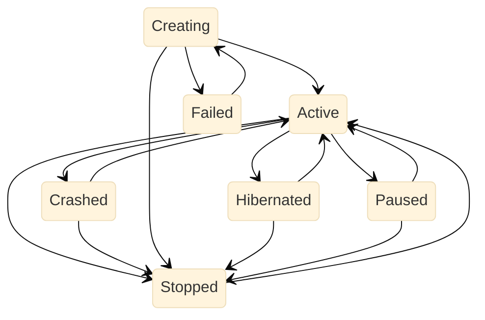

# Session lifecycle

Generated from `session/state_machine.go`'s `transitionDefs`. Regenerate with:

```sh
go test ./session -run '^TestSessionLifecycleDiagram$' -update-session-lifecycle-diagram
```



This graph shows table-validated lifecycle transitions, not every status write. `Restoring` and `PermanentlyFailed` are statuses outside this transition table. Detected agent states (processing, idle, approval/input required), retry budgets, and `ArchivedAt` are separate dimensions; they are not nodes in this lifecycle graph. Edges describe legality, not permission to auto-revive an archived session.
