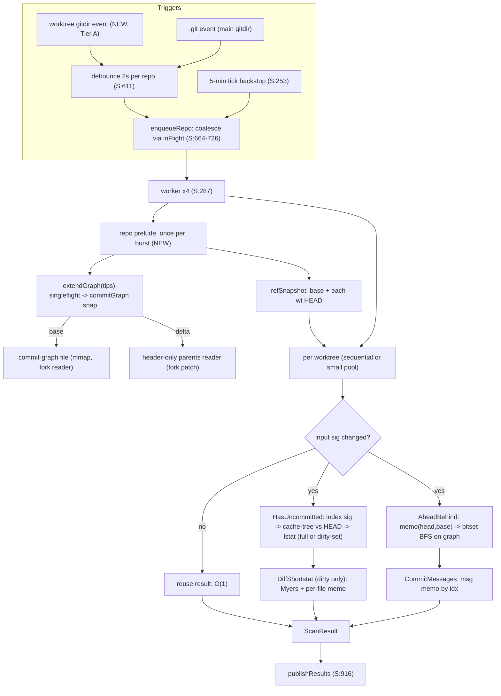

# Research: Architecture — unfinished-scanner-dsa-perf

> **Superseded by ADR-001 and ADR-009 (and `implementation/plan.md`).** This is Phase 2 research and is kept for its evidence only. Its design of record is **not** current: the copy-on-write `commitGraph.snap`/`graphSnap` snapshot with one writer mutex per `repoState` (the concurrency section), the "delta segment", the `repoState`-held `sync.Map` and the lock order `entry.mu -> repoState.mu` were replaced by the lock-free chunked arena, per-row atomic state and generation pointer (ADR-009), the extension-slot attachment to `SharedObjectStore` (ADR-001), and the written lock chain. Name mapping is in the plan's glossary ("Research names -> plan names"). Do not implement from this file.

**Date**: 2026-10-15 · **Phase**: SDD 2 (research only, no code changed) · **Dimension**: target architecture and data structures

Labels: **VERIFIED** = file opened or command run (cited). **INFERRED** = reasoning from verified facts. **UNVERIFIED** = needs a Phase 3/5 check.
Line refs are to this worktree at HEAD `150168a4c`; `gogit_vcs_reader.go` is written `G:` below, `scanner.go` as `S:`.
Hard rule honoured: go-git only; every gap below is filled by this package or by a fork patch on `tstapler/go-git` `ssq/v5`.

---

## 0. Summary of findings

1. **Today's duplication is real and exactly where `AGENTS.md` says.** Per-worktree-keyed state: `reachableSetCache` (G:533, keyed by worktree path at G:1393/1405), `aheadBehindCache`/`commitMessagesCache` (key = path+base, G:1247/1314), `matcherCache` (G:601, G:1005), `headTreeCache` inside `cachedRepo` (G:333-334, `cachedRepo` is per path, G:2088). `parentMemo` is created **per `AheadBehind` miss** (G:1291, G:2200) and dies with it, so even within one repo the same commit is re-decoded for every worktree and every miss. VERIFIED.
2. **The object layer is already shared; the derived layer is not.** `gogitstore.Registry` shares the decoded-object cache and pack indexes per resolved common dir (G:2075-2084; `design/pluggable-gitstore.md` §4). It does not share anything computed *from* objects. The new state slots in directly above it. VERIFIED.
3. **Commit-graph is available locally but go-git does not read it.** `~/code/github.com/tstapler/stapler-squad/.git/objects/info/commit-graph` exists, 535,292 bytes, header `CGPH 01 01 04` = version 1, SHA-1, 4 chunks (`xxd`, VERIFIED). The `tstapler/go-git` checkout has none (`ls`). `storage/filesystem/*.go` in the fork has zero references to commit-graph (`grep`, VERIFIED), so `Repository.Log`/`CommitObject` never use it. The fork ships `plumbing/format/commitgraph/v2` (`Index` interface with `GetIndexByHash`, `GetCommitDataByIndex`, generation, `OpenChainOrFileIndex`; VERIFIED in `v2/commitgraph.go`, `v2/chain.go:48`). The reader exists; the wiring to our own consumer does not. Whether the user's *other* repos carry one is UNVERIFIED (must tolerate absence).
4. **Disposition: Isolate via seam** (section 9).

---

## 1. Per-repo shared state

### 1.1 Key and lifetime

Key = **resolved common git dir** (`EvalSymlinks` + `filepath.Clean`; macOS `/var` vs `/private/var` must canonicalise to one key). This is the key `gogitstore.Registry` already uses (design doc §4: "keyed by resolved, filepath.Clean'd commondir"). `gitCommonDir()` (G:2021-2046) is an uncached `os.ReadFile` per call and does not resolve symlinks, so the key must come from `gogitstore.Open`'s own resolution (expose it), not from re-deriving. The hash axis is the content-addressed object ID, so most derived products are immutable by construction.

New type `repoState`, held in a `sync.Map[commonDir]*repoState` on `GoGitVCSReader` (zero-value-safe like the other fields), pointer also cached on each `cachedRepo` at open. Lifetime = refcount of `cachedRepo`s pointing at it, mirroring `releaseGogitstoreRef` (G:382-389): decremented on every `repoCache` eviction path (`pruneRepoCache` G:402-437, `ClearCache` G:475, discarded duplicate open G:2102). A `repoState` whose refcount is 0 *and* idle past a TTL is dropped by the same prune pass. It is a sibling of `gogitstore.SharedObjectStore`, not a field in it: `gogitstore` must not import `unfinished` (cycle) and the derived state needs go-git `object` types.

### 1.2 What is shared vs per-worktree

Rule used: share a thing iff git's own layout makes its *inputs* common. `design/pluggable-gitstore.md` §2 already records the split (`objects/, refs/, packed-refs, config, info/, shallow, worktrees/` common; `HEAD`, `index`, `ORIG_HEAD`, `logs/HEAD`, `refs/bisect`, `refs/worktree` per worktree). VERIFIED (doc text).

| Item | Shared per repo? | Key | Why / caveat |
|---|---|---|---|
| Commit parent graph (idx, parents, gen, commit time) | **Yes** | commit hash (interned to uint32) | Content-addressed, immutable. Only `.git/shallow` (common) changes parent availability; negative entries ("object not found, skip" G:2243) must carry the shallow-file stat signature. `replace` refs/grafts: go-git ignores them today; unchanged. |
| Reachable set of a base | **Yes** | base commit hash | Pure function of graph + `maxReachableSetCommits` cap. Today keyed by worktree path (G:1393). |
| Ahead/behind result | **Yes** | (head hash, base hash) | Pure function of two hashes (and L). Replaces the path+ref-name key (G:1247) and removes TTL need for the *result*; TTL only guards ref resolution. |
| `behind` count | **Yes** | (base hash, merge-base idx) | Identical for every worktree that shares base and merge base (G:1300). |
| Commit first-line message | **Yes** | commit idx | Immutable; `CommitMessages` walk G:1367-1376 decodes the full commit just for `firstLine`. |
| HEAD tree path→blob map | **Yes** | **tree hash** (not path) | `headTreeCache` (G:333) is per `cachedRepo`, rebuilt per worktree per HEAD move by an O(n) tree walk (G:918-933). Two worktrees on the same commit or sharing subtrees recompute it. |
| Compiled gitignore *pattern parse* | **Yes** (memo) | (dir, `.gitignore` content hash) | Parsing is pure. |
| Gitignore **matcher** (composition) | **No — per worktree** | worktree | `gitignore.ReadPatterns(osfs.New(worktreePath))` (G:1017) reads *working-tree* `.gitignore` files, which differ per worktree and are not tied to HEAD. The current `matcherCache` validated only by `headTreeHash` (G:1007) already admits staleness (G:355-357). `.git/info/exclude` is common and can be parsed once and shared. |
| Index (parsed entries, stat signature) | **No** | worktree | `index` is per worktree (§2 of the design doc). |
| HEAD ref, refs/worktree/* | **No** | worktree | Per worktree. (Branch refs and `origin/main` are common; every worktree sees a base move.) |
| Dirty state, untracked cache, watcher dirty-set, TTL result entries | **No** | worktree | Depend on the working directory. |

### 1.3 Relation to `Registry`, `cachedRepo`, `entry.mu`

```
GoGitVCSReader
 ├─ gogitstoreRegistry ─ SharedObjectStore[commonDir]   (objects, pack idx; existing)
 ├─ repoStates ─ repoState[commonDir]                   (NEW: derived, hash-keyed)
 │     ├─ commitGraph   (atomic.Pointer[graphSnap])
 │     ├─ products      (reach bitsets, ab memo, behind memo, msg memo, tree maps) LRU by bytes
 │     └─ refSnapshot   (atomic.Pointer; refs resolved once per burst)
 └─ repoCache ─ cachedRepo[worktreePath]                (existing: repo handle + entry.mu + per-wt state)
       ├─ *repoState (pointer)
       └─ index sig/parsed index, untracked cache, matcher, dirty-set
```

`entry.mu` stays exactly what its doc says (G:319-323): the lock around one worktree's `*git.Repository` object access. It is **not** widened to the shared state. Shared state gets its own copy-on-write snapshot discipline (section 5) so that W worktrees never contend on a repo-wide mutex for reads. Note the design doc already accepted one per-commondir mutex in `lockedIndex` for pack-index lookups (§4.2, microsecond-scale); the graph must not add a second hot one.

---

## 2. Compact data structures

### 2.1 Commit graph (replaces `parentMemo` + all per-call `map[Hash]…`)

Intern every commit hash to a dense `uint32` id once per repo. Columnar arena, append-only:

```
type graphSnap struct {            // immutable once published
    base   commitgraph.Index       // mmap'd commit-graph file segment (may be nil); ids [0,nBase)
    nBase  uint32
    // delta segment: commits newer than the graph file (or when none exists)
    dHash  []plumbing.Hash         // sorted for binary search → idx = nBase + position-in-insertion-order via perm
    dPar   [][2]uint32             // first/second parent idx; NoParent = ^uint32(0); octopus → side table
    dGen   []uint32                // generation number, 1+max(parent gen)
    dTime  []uint32                // commit time seconds (optional; for time-ordered stop rules)
    octo   map[uint32][]uint32     // rare >2-parent commits
}
```

- **Base segment is zero-copy**: `commit-graph` is already an OID fanout + parent table + generation (CDAT) in sorted order. Reading it through the fork's `v2.Index` gives hash→idx (`GetIndexByHash`), idx→parents/generation (`GetCommitDataByIndex`) with **no commit decode and no heap map** (VERIFIED interface). If mmap'd the memory is page cache, not Go heap — directly helping the GC-mark share (28% flat, `requirements.md:12`). Note `v2.GetCommitDataByIndex` returns `*CommitData` (heap) per call; a fork patch should add an allocation-free accessor, e.g. `ParentsByIndex(i uint32, buf *[2]uint32) (n int)` and `GenerationByIndex(i)`. (Fork patch #1, additive.)
- **Delta segment** covers commits newer than the last `git gc/fetch` graph write (the graph is a snapshot; fresh local commits are exactly what the scanner cares about). Built on demand by walking from unknown tips using a **header-only parents reader** (fork patch #2: `object.ParentsOf(storer, hash) ([]Hash, time, error)` stopping at the first blank line, no message/gpgsig buffers — targets the allocs profile `bytes.growSlice 30.8%, MemoryObject.Write 10.8%, bufio.ReadBytes 10.3%, continuationCont 9.2%`, `requirements.md:13`). Delta is compacted into a new base-like sorted segment when it exceeds ~4k commits.
- **Absent commit-graph** (UNVERIFIED how common): whole history lives in the delta segment, populated incrementally by the header-only reader, bounded by `maxGraphCommits` (≥ existing `maxReachableSetCommits` = 50,000, G:2154). The fork may also *write* a commit-graph (`commitgraph` has `encoder.go`) as a later optimisation — not required.
- Generation number for delta commits computed at insertion, parents inserted first (post-order), so the invariant `gen(c) > gen(parent)` always holds; a missing parent (shallow) gets a boundary flag and gen 1.

### 2.2 Reachable sets → bitsets

A reachable set is a subset of a dense id space, and ids come from graph order (commit-graph files sort by hash, so ids are *not* topological; for the delta they are insertion-post-order). Plain `[]uint64` bitset sized to `maxID/64`; **roaring is not needed** (stdlib-only; sets from one base are dense relative to the ids a repo hands out, and the cap R=50,000 bounds N). Revisit roaring only if a repo exceeds ~2M interned commits (INFERRED, not a target repo size per `requirements.md:42`).

### 2.3 Bytes per commit, before vs after (INFERRED from Go layout; to be measured by the Phase 5 benchmark with `-benchmem`)

| Structure | Today | Proposed |
|---|---|---|
| Reachable set | `map[plumbing.Hash]bool`: 20 B key + 1 B val, Go map load factor + bucket/ctrl overhead ≈ **~40-50 B/commit** (50k ⇒ ~2-2.5 MB) **per worktree** (G:210-213, G:2158-2175) | **1 bit/commit** per base: 50k ⇒ **~6.1 KB**, once per (repo, base) |
| Parent memo | `map[Hash][]Hash`: 20 B key + 24 B slice header + 20·np B backing (24-32 B size class) + map overhead ≈ **~100-150 B/commit**, rebuilt per `AheadBehind` miss (G:2195-2214) | graph delta: 20 B hash + 8 B parents + 4 B gen (+4 B time) ≈ **~36 B/commit**, **0 B on heap for commits already in the commit-graph file** (mmap), shared by all worktrees, persists across misses |
| BFS `seen` | `map[Hash]struct{}` / `map[Hash]bool` allocated per call, per side (G:2224, G:2289) | one reusable `[]uint64` visited bitset + `[]uint32` queue from a `sync.Pool` sized to the graph; **0 allocs on warm path** |
| HEAD tree map | `map[string]plumbing.Hash` ≈ 16 B string header + path bytes (~40-60) + 20 B hash + overhead ≈ **~110 B/file** per worktree per HEAD (G:918) | path interned once per repo (`uint32` pathID), per-tree columnar `[]struct{pathID uint32; hash Hash}` sorted by pathID ≈ **~24 B/file**; shared by tree hash |

These are order-of-magnitude estimates (INFERRED); the gate in Phase 5 is a measured `-benchmem` comparison, not these numbers.

### 2.4 Big-O, before vs after (per cache miss; n tracked files, f walked files, W worktrees, L=2000, R=50,000, d commits to merge-base, a/b ahead/behind, c changed files since last scan, D edit distance, m,k file line counts)

| Operation | Before (cite) | After | Note |
|---|---|---|---|
| `findMergeBase` | O(d1+d2) **decodes**, two `map` allocs, memo discarded each call (G:2261-2279, G:1291) | O(d1+d2) **integer steps**, 0 decodes warm; O(Δ new commits) decodes once per repo; result memoised on (head, base) ⇒ O(1) repeat | Big-O of steps unchanged; the win is constant factor (decode ≈ µs-ms vs ns) and W×. Optional later: generation-ordered paint-down-to-common finds the *best* merge base — **not parity-safe** (see risk R1). |
| `countCommitsTo` ×2 | O(a)+O(b), cap L, `seen` map per call, W× (G:2288-2311) | `ahead`: O(a) over bitset visited; `behind`: memo (base, mb) ⇒ **O(b) once per repo**, O(1) for the other W−1 | `min(exact, L)` equals the capped DFS count, so counts are parity-exact; only the traversal order differs, which does not change the count. |
| `reachableSet` (`cachedReachableSet`) | O(R) **decodes** + O(R) map inserts per (worktree, base): **O(W·R)** on base move (G:1392-1406, G:2158) | O(R) integer ops once per (repo, base); **incremental** O(Δ) when the previous base is an ancestor of the new base (walk new tips, stop at bitset members, OR into a copy) | 2.5 MB × W → ~6 KB × (#distinct bases). |
| `CommitMessages` phase 3 | O(a) full commit decodes per worktree per miss (G:1360-1376) | O(a) idx lookups + per-commit message memo; decode only first time per commit, shared | |
| `HasUncommitted` clean worktree | O(n) index decode + `trackedFile` copy (`n` allocs, G:1079-1082) + O(n) `indexNames` map (G:1059) + O(n) lstat (G:1130-1149) + O(f) untracked walk | **Tier A**: index parse skipped when index stat signature (mtime, size, inode) unchanged ⇒ O(1); staged-vs-HEAD O(1) when index cache-tree root == HEAD tree hash else O(n) (`index.Tree` exists in the fork, `plumbing/format/index/index.go:171`; population by a given writer UNVERIFIED); untracked walk O(dirs) with per-dir mtime pruning (git's UNTR idea); lstat still O(n). **Tier B** (armed watcher): O(c) | Early-exit ordering already puts cheap positives first (AGENTS.md); the *clean* case is the always-full-cost one, which is why Tier B matters. |
| `diffShortstat` | per modified file LCS DP O(m·k) time/space, repeated every miss for every dirty file (G:1828-1856, G:1907-1941) | Myers O((m+k)·D) over int-interned lines (linear-space variant); per-file memo keyed (blob hash, size, mtime ns) ⇒ unchanged dirty file costs O(1) on the next miss ⇒ O(changed) per miss | Parity is exact: Myers yields the shortest edit script length D = m+k−2·LCS, so insertions = k−LCS and deletions = m−LCS equal the current LCS-derived counts (math argument, INFERRED; Phase 5 proves it with the oracle corpus, `walkers_oracle_test.go` is the existing pattern). |
| HEAD tree map | O(n) tree walk + map build per worktree per HEAD move (G:894-963) | per tree hash, shared; subtree-hash short-circuit: diff old vs new HEAD touching only differing subtrees ⇒ O(changed paths); first build O(n) once per repo | |
| Scanner total | Σ_W (all rows) × event rate (AGENTS.md table; G:616-621 widens to all worktrees on a commit/fetch event) | O(graph extend, once per burst) + Σ_W O(cheap int ops + c) | |

---

## 3. Scanner scheduling

### 3.1 What the code does today (VERIFIED)

- 4 workers (`S:287`), one `scanTask` per **repo** (`S:721`), coalesced via `inFlight` (`S:716`). Inside a task worktrees are scanned **sequentially** (`S:765`), each through its own TTL cache (`S:819-825`).
- `.git` events are classified (`S:594-605`) and debounced per repo with a fixed 2 s window (`fsnotifyDebounce`, `S:575`; `scheduleGitEvent` `S:611-645`). A commit/fetch-type event widens to all worktrees (`S:616-617`, `invalidateRepo`).
- Only `<repo>/.git` (the main worktree's git dir) is registered with fsnotify (`watchRepo`, `S:495-509`). Linked worktrees' own `HEAD`/`index` live under `.git/worktrees/<name>/` and are **not** watched; `classifyGitEvent`'s comment (`S:586-592`) says index/config only describe the main worktree. So for linked worktrees the only change signals are common-dir events (packed-refs/FETCH_HEAD/...) and the 5-minute backstop tick (`S:253`, `coordinator` `S:461-475`). INFERRED from the comment and the single `w.Add(gitDir)`; confirm by watching a linked worktree commit in a manual instance.
- TTL: `diffStatCacheTTL = 30 s` (G:37) for results; `enqueueRepo` skips the whole repo if *any* worktree cache is fresh (`S:709`).

So the W×event-rate multiplier is: **one commit/fetch event on a repo ⇒ all W worktrees run the full miss path** (`HasUncommitted`, `AheadBehind`, `CommitMessages` if ahead>0, `DiffShortstat` if dirty — `S:827-871`), each with private caches.

### 3.2 Target

1. **Per-burst repo prelude, once per repo.** At task start (before the worktree loop, `S:762` region) build a `repoSnapshot` (immutable, `atomic.Pointer` in `repoState`): resolve base ref once, resolve each worktree's HEAD once, extend the commit graph for the union of tips in a single walk (singleflight on `(commonDir, "extend")`). Pass it to `scanWorktree`. After that, ahead/behind per worktree is integer work.
2. **Skip by input signature.** Per worktree compute `sig = (HEAD hash, base hash, index stat sig, dirtyGen, shallow sig)`. If `sig` equals the last scanned sig and no watcher dirty events, committed-state fields (ahead/behind/messages) are valid **indefinitely** (hash-pure) and are not subject to the 30 s TTL; only the working-tree fields consult dirty state.
3. **Order**: scan worktrees whose sig changed first; unchanged ones are O(1).
4. **Parallelism inside a repo**: with no repo-wide lock held across IO, the per-repo loop can fan out over a small bounded pool (`min(W, 2)`) — INFERRED benefit, but bounded because the machine runs at load 110-160 (`requirements.md:8`): more concurrency is not free. Decide by benchmark, default off.
5. **Hot-path guard**: `UnderSeverePressure` check stays at `enqueueRepo` (`S:678`); add the same check before graph extension (largest allocation in the new design).

### 3.3 Watcher-driven dirty-path sets, with a safe fallback

Constraint: a false "clean" hides unfinished work (the harm), a false "dirty" costs one extra scan (benign). Design for asymmetric safety.

- **Tier A (default, no new watches beyond a handful of files)**: watch each linked worktree's *gitdir* (`.git/worktrees/<name>/`, ~10 entries: `HEAD`, `index`, ...) so HEAD moves and index rewrites (`git add`, commit, checkout) are observed. Gives the staged/commit signals the code currently misses for linked worktrees. Working-tree content edits remain covered by the O(n) lstat pass (already dir-fd optimised, PR #1038) plus the untracked-dir-mtime cache.
- **Tier B (opt-in, only for "hot" worktrees: those with a live session)**: recursive watch of the working tree, events → `dirtyPaths set[pathID]`, so `HasUncommitted` stats only dirty paths (O(c)). Risks that force bounded scope: fsnotify v1.10.1 (`go.mod:28`) uses kqueue on darwin, which consumes **one fd per watched file/dir** (INFERRED from fsnotify's documented backend; UNVERIFIED for this version — verify before any Tier B work) so watching a 30k-file tree is not viable. Mitigation: watch **directories only** (not files; kqueue dir events fire on entry create/delete/rename, but **not** on an in-place write to an existing file) — so Tier B on darwin cannot observe modifications to existing tracked files without file-level watches. Conclusion (INFERRED): on macOS Tier B is only sound for the *untracked-set* and for a small fd-budgeted set of already-dirty files; the tracked-file `lstat` pass (O(n), cheap since dirfd) stays. Linux (inotify) could do better but this machine is darwin. This is the central open question for Phase 3 (see §8).
- **Fallback to full walk** on any of: watcher not armed; `fsnotify.ErrEventOverflow`/`w.Errors`; a directory rename/remove event (subtree unknown); armed-at generation older than the last `Write` loss; worktree not scanned within `K` (reuse the existing 5-minute coordinator tick, `S:253`) — **every K the full pass runs regardless**, bounding the worst-case staleness of a missed event to K. First scan after arming is always a full walk (baseline).
- A watcher *hit* is allowed to short-circuit to `dirty=true` immediately; a *clean* verdict requires either a full pass or an armed watcher with zero events and no loss since the last full pass.

---

## 4. Invalidation and memory budget

**Invalidation principle**: hash-keyed products never need invalidation, only eviction. Mutable inputs are resolved fresh or guarded by signatures.

| Input | Mutates? | Guard |
|---|---|---|
| Commit graph entries, reach bitsets, ab/behind/message/tree-map memos | No (content-addressed) | none; eviction only |
| Branch/base refs, worktree HEAD | Yes | resolved per burst into `refSnapshot`; `.git` events (`S:611`) drop it. `InvalidateWorktree` (G:1413-1416) keeps its current meaning for TTL entries. |
| Index | Yes | stat signature; parse cache per worktree |
| `.git/shallow` | Yes | stat signature stored with negative ("not found") graph entries |
| New packs after fetch | Yes | unknown hash ⇒ graph extend; negative entries re-probed on pack-dir mtime change |
| gc/prune | Removes unreachable objects | memoised answers for a hash stay correct about that hash's ancestry; harmless |
| Working-tree `.gitignore` | Yes | matcher stays per worktree, rebuilt on `.gitignore`-blob change (existing `gitignoreEntriesChanged`, G:971-991) or `.gitignore` mtime; shared piece is only pattern parse memo |

**Budget** (builds on existing, VERIFIED): today `repoCache` is budgeted at 3 GB / ~96 MB per repo (G:231, G:250), shrinking at 1.5×/2× heap thresholds (`effectiveCacheBudgetBytes`, G:285-295), `UnderSeverePressure` (G:315) gates scans (`S:678`), `PruneToMemoryBudget` runs every minute (`S:324-335`) and `ClearCache` is the severe valve (`S:331-333`). Add, without changing those:

1. `repoState.bytes()` = sum of segment/bitset/memo sizes (O(#slices), no walk). Surface in `RepoCacheStats` and `metrics.go` alongside hit/miss/eviction counters (observability requirement, `requirements.md:81`).
2. **Eviction order** inside `PruneToMemoryBudget` (cheapest to rebuild first): (a) idle-past-TTL `repoState`s with refcount 0; (b) derived-product LRU by bytes: reach bitsets, message memo, tree maps (each recomputable in O(R) int ops or one tree walk); (c) delta graph segment (rebuild = re-walk with header-only reader); (d) never the mmap'd base segment (page cache, not heap).
3. **Severe pressure** (`UnderSeverePressure`): drop (b)+(c) wholesale, do not extend graph, serve last-known-good results (same stale-over-failed policy as `S:670-683`).
4. Hard caps: `maxGraphCommits` per repo (≥ 50k, tunable var for tests like `maxReachableSetCommits`), memo entry caps; per-product off-switch flag (risk control, `requirements.md:84`).

Memory arithmetic (INFERRED): a 50k-commit repo with no commit-graph file: ~36 B × 50k ≈ **1.8 MB** shared for the graph + ~6 KB per base bitset, versus today's W × (≈2.5 MB reach set + ≈5-7 MB transient parent memo per miss). With a commit-graph file the heap cost for the covered commits is ~0.

---

## 5. Concurrency model

Consistent with `.claude/rules/instance-lock-free-reads.md` (lock-free reads via published immutable snapshots; mutate under a lock and republish) and `project_plans/perf-mutex-hotspots-2026-07/decisions/ADR-001` (per-method `singleflight.Group`s, lock *inside* the `Do` body).

- **Readers lock-free.** `commitGraph.snap atomic.Pointer[graphSnap]`; `refSnapshot atomic.Pointer`. A snapshot is immutable once stored; arena slices are append-only and a snapshot records `len`, so a reader never observes a partial append. Warm-path cache hits stay allocation-free (existing rule, AGENTS.md "cache hit must stay allocation-free").
- **Writers**: one `sync.Mutex` per `repoState` held **only** to merge a pre-built delta into a new snapshot and `Store` it. The expensive part — header-only decodes of unknown commits — runs **outside** that mutex, under `entry.mu` of the *triggering* worktree and only around go-git object access (existing discipline, AGENTS.md "Rules for changes here"). Duplicate decode by two worktrees extending different tips is bounded and deduped at merge (check-then-insert under the writer mutex).
- **singleflight per repo key** (new groups, one per method per ADR-001): `extendSF` key `(commonDir, tipSetHash)`, `reachSF` key `(commonDir, baseHash)`, `abSF` key `(commonDir, headHash, baseHash)`, `treeSF` key tree hash. Replaces keys that today include the worktree path (G:1247, G:1314) so W workers asking the same question coalesce into one computation instead of W.
- **No repo-wide lock across a stat walk** (NFR, `requirements.md:43`): the stat walk stays in per-worktree state with no shared lock; `hasUncommittedGoGitPhase` keeps releasing `entry.mu` before stat (G:1041-1084, G:1126).
- **Lock order**: `entry.mu` (per worktree) → `repoState.mu` (writer merge only). Never the reverse; the merge never calls go-git. `lockedIndex` mutex (pack index lookups, design §4.2) is a leaf.
- **Invalidation race**: the existing `invalidationGen` + `guardInvalidation` pattern (G:1432-1449) covers TTL entries; hash-keyed memos need no guard. A graph extension in flight when `ForgetWorktree` drops the worktree is harmless (shared, hash-keyed).
- **`*Instance` reads** (the rule's subject) are outside this package's scanner state; where scanner call sites read `*Instance` fields they continue to go through `Snapshot()`. No new `*Instance` coupling is introduced.

---

## 6. Data flow



Per-worktree state (index sig, parsed index, untracked cache, matcher, dirty-set) lives on `cachedRepo`; everything hash-keyed lives on `repoState`.

---

## 7. Fork patches implied (additive, one tag each; `ssq/v5`, consumed via `replace`, `go.mod:231`)

| # | Patch | Replaces | Revertable |
|---|---|---|---|
| F1 | Allocation-free accessors on `commitgraph/v2.Index` (parents/generation by idx into caller buffers) | per-call `*CommitData` heap | yes |
| F2 | Header-only commit parents reader (`ParentsAndTime(storer, hash)`) | `CommitObject` full decode in `parentMemo.get` (G:2208), `reachableSet` (`Log`, G:2160), `CommitMessages` | yes |
| F3 | (maybe) Myers line diff in `plumbing/utils/diff` or here (preferred: here, so no patch) | `lcsLength*` (G:1828, G:1907) | n/a if kept local |
| F4 | (maybe) accessor for index cache-tree validity if the existing `index.Tree` isn't populated/parsed usefully | O(n) staged compare | yes |

Order per AGENTS.md preference: (1) better algorithm here, (2) cache/avoid, (3) fork patch. F1/F2 are justified because decode cost is unavoidable for commits outside any commit-graph file.

---

## 8. Risks and open items for Phase 3

- **R1 — merge-base parity.** `findMergeBase` returns the *first common ancestor met by lockstep BFS*, not necessarily git's best merge base (G:2254-2279). Ahead/behind depend on which commit is chosen on criss-cross histories. Phase 5 must preserve the exact (queue-order, parent-order, cap) semantics on interned ids and gate any switch to generation-ordered paint-down-to-common behind a flag + oracle corpus, or the counts change. (VERIFIED reading; impact INFERRED.)
- **R2 — capped-walk parity.** BFS vs DFS visits different commits at the cap L; counts remain `min(exact, L)`, but `findMergeBase` failing "within L per side" depends on BFS order — keep BFS there (G:2276).
- **R3 — kqueue fd cost / blindness to in-place edits** makes Tier B darwin-limited (§3.3). Needs a measured fd budget and an explicit owner decision; Tier A + O(1) skip-by-signature + dir-mtime untracked cache is the safe default.
- **R4 — gitignore sharing is narrower than the requirements assume** (`requirements.md:48,90`): only the pattern *parse* and `info/exclude` are shareable; the matcher is per worktree (§1.2).
- **R5 — commit-graph staleness**: the file covers only commits at last write; correctness comes from the delta segment, never from assuming the graph is current.
- **R6 — index cache-tree**: whether git-written indexes carry a valid TREE extension for the cases we need (and that go-git parses it into `index.Tree`) is UNVERIFIED; fallback is the existing O(n) compare.
- **Open questions answered here**: (Q1 requirements) commit-graph exists at least on the stapler-squad checkout, v1/SHA-1 (VERIFIED); fork reads graphs but does not wire them into storage. (Q4) shared safely: commit graph, reach sets, ab/behind, messages, tree maps, pattern-parse memo; not shared: matcher composition, index, dirty state.
- **Not examined (time/load)**: whether the running binary predates `c46c69faf` (requirements Q2); `session/unfinished/metrics.go` extension points beyond `RegisterMetrics` (`metrics.go:22`); the fork's `index.Tree` population behaviour.

---

## 9. Disposition for the touched area (SDD hotspot rule)

**Isolate via seam.** `gogit_vcs_reader.go` is 2,311 lines mixing caching, locking, git access and algorithms, so refactoring it first would stall the work and churn a hot file; instead introduce a small `repostate` seam (commit graph + products behind a narrow interface consumed by `AheadBehind`/`CommitMessages`/`resolveHeadTreeHashes`) and migrate one call site at a time behind a per-product flag, with the existing characterization tests (`gogit_vcs_reader_mergebase_test.go`, `walkers_oracle_test.go`) pinning behaviour. Extract `AheadBehind`'s inner closure (G:1257-1305) into a pure function over the graph interface as the first, mechanical step.

## 10. Staged rollout (maps to requirements risk control)

1. Benchmarks + oracle corpus (decode count across ≥3 worktrees of one repo — the success metric, `requirements.md:24`).
2. `repoState` + shared graph + (head,base) memo, flag-gated; F2 header-only reader.
3. Reach bitsets + behind memo + message memo; delete `reachableSetCache` path-key.
4. HEAD tree sharing; index-signature skip; Myers + per-file memo.
5. Tier A watches; Tier B only if the fd budget and owner decision allow.
6. Manual-instance soak on `:62871` before any live deploy (`requirements.md:84`).
